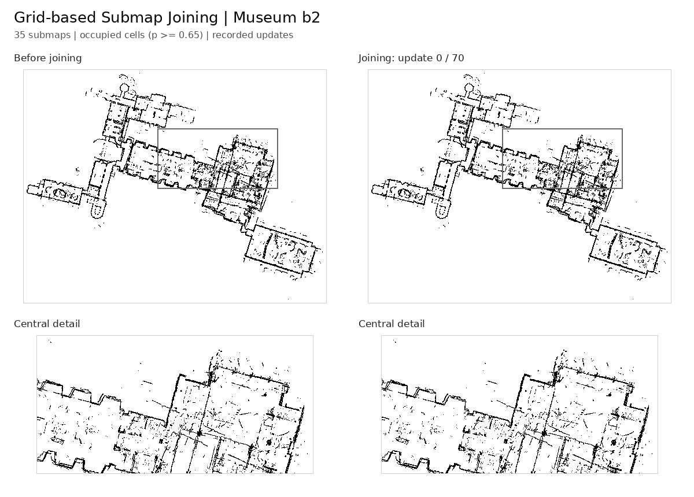

# Grid-based Submap Joining: An Efficient Algorithm for Simultaneously Optimizing Global Occupancy Map and Local Submap Frames

Yingyu Wang, Liang Zhao, and Shoudong Huang
**IROS 2024** · [Paper](https://arxiv.org/abs/2501.12764) · [Video](https://www.youtube.com/watch?v=jZEnyrKXRBw) · [DOI](https://doi.org/10.1109/IROS58592.2024.10802536)

ROS 2 / C++17 implementation for jointly optimizing a global 2D occupancy map
and local submap frames using global-to-local projection and a pose-only Schur solve.

[](https://www.youtube.com/watch?v=jZEnyrKXRBw)



*b2 with controlled initial submap frames.*

## Installation

### Get the source

Install Git and Python 3, then clone the repository:

```bash
git clone https://github.com/WANGYINGYU/Occupancy-Joining.git
cd Occupancy-Joining
export OCCUPANCY_JOINING_WORKSPACE="$(realpath -m ../occupancy-joining-workspace)"
```

Run subsequent commands from the repository root. The workspace stores outputs and logs.

### Docker

Ubuntu 24.04 with [Docker Engine](https://docs.docker.com/engine/install/ubuntu/).
The Docker image includes ROS 2 Jazzy, slam_toolbox, RViz and the C++/Python dependencies.

```bash
bash tools/docker.sh build
```

### Native ROS 2

Ubuntu 24.04 with [ROS 2 Jazzy](https://docs.ros.org/en/jazzy/Installation/Ubuntu-Install-Debs.html).

Install the system dependencies:

```bash
sudo apt update
sudo apt install -y build-essential cmake python3-colcon-common-extensions \
  python3-venv python3-pip python3-numpy python3-scipy python3-yaml \
  python3-pil libeigen3-dev libyaml-cpp-dev \
  libboost-serialization-dev ros-jazzy-ament-cmake \
  ros-jazzy-slam-toolbox ros-jazzy-rviz2 ros-jazzy-rmw-fastrtps-cpp
```

Create the Python environment and compile:

```bash
/usr/bin/python3 -m venv --system-site-packages .venv
source .venv/bin/activate
python3 -m pip install -r requirements.txt
source /opt/ros/jazzy/setup.bash
export CMAKE_BUILD_PARALLEL_LEVEL=2 MAKEFLAGS=-j2
bash tools/build.sh
source install/setup.bash
```

In a new terminal, enter the repository and activate the environment:

```bash
export OCCUPANCY_JOINING_WORKSPACE="$(realpath -m ../occupancy-joining-workspace)"
source .venv/bin/activate
source /opt/ros/jazzy/setup.bash
source install/setup.bash
```

## Demo

### Docker

```bash
python3 demo/run.py --demo b2 --work "$OCCUPANCY_JOINING_WORKSPACE/b2-demo"
bash tools/docker.sh --gui view --result "$OCCUPANCY_JOINING_WORKSPACE/b2-demo/results"
```

### Native ROS 2

```bash
python3 demo/run.py --demo b2 --native --work "$OCCUPANCY_JOINING_WORKSPACE/b2-native-demo"
bash tools/occupancy-joining view --result "$OCCUPANCY_JOINING_WORKSPACE/b2-native-demo/results"
```

## Input Data and Configuration

The pipeline partitions scans, initializes submap frames from the input trajectory,
and computes local/global grid origins and dimensions automatically.
Copy the profiles to set paths, topics, resolutions and submap partitioning:

```bash
cp -r src/occupancy_joining/config ../occupancy-joining-config
```

YAML paths resolve relative to the configuration file. Docker mounts the configuration
folder automatically; `--mount-input` mounts the referenced data directory at the same host path.

### TXT scans and poses

Provide one range row and one pose/odometry row per scan:

| File | Format |
| --- | --- |
| `Range.txt` | Space-separated ranges in metres; one scan per row, one beam per column |
| `Pose.txt` | Absolute sensor-to-world `x y yaw`, in metres and radians |
| `Odom.txt` | Alternative to `Pose.txt`: first absolute pose, then SE(2) increments in the preceding sensor frame |

Beam angles are uniformly spaced from `angle_min` to `angle_max`. Set the sensor geometry
and independent map resolutions in `../occupancy-joining-config/txt.yaml`:

```yaml
input:
  type: txt
  dataset: /absolute/path/to/txt_dataset
  angle_min: -2.356194490192345
  angle_max: 2.356194490192345
  min_range: 0.1
  max_range: 30.0
submaps:
  local_resolution: 0.1
optimizer:
  global_resolution: 0.1
display:
  resolution: 0.05
```

```bash
# Docker
bash tools/docker.sh --mount-input /absolute/path/to/txt_dataset run \
  --config ../occupancy-joining-config/txt.yaml \
  --output "$OCCUPANCY_JOINING_WORKSPACE/txt-result"

# Native ROS 2
bash tools/occupancy-joining run \
  --config ../occupancy-joining-config/txt.yaml \
  --output "$OCCUPANCY_JOINING_WORKSPACE/txt-result"
```

### ROS bags

ROS1 input is a `.bag` file; ROS2 input is a bag directory.
LaserScan, MultiEchoLaserScan and PointCloud2 are supported.
Bag scans pass through slam_toolbox before submap joining.

Inspect the recording:

```bash
# Docker
bash tools/docker.sh inspect /absolute/path/to/bag_directory/recording.bag

# Native ROS 2
bash tools/occupancy-joining inspect /absolute/path/to/bag_directory/recording.bag
```

Edit `rosbag_laserscan.yaml` for laser scans or `rosbag_pointcloud.yaml` for point clouds.
Keep `slam_toolbox.yaml` alongside the selected profile.

```yaml
input:
  type: bag
  dataset: /absolute/path/to/bag_directory/recording.bag
bag:
  scan_topic: /laser_scan
  odom_source: auto
  odom_topic: /wheel/odom
  tf_topic: /tf
  tf_static_topic: /tf_static
  odom_frame: odom
  slam_config: slam_toolbox.yaml
```

For PointCloud2, also configure `projection_frame`, `min_height`, `max_height` and `bins`.
The profile controls the input topic names and the point-cloud slice used for 2D mapping.

```bash
# Docker
bash tools/docker.sh --mount-input /absolute/path/to/bag_directory run \
  --config ../occupancy-joining-config/rosbag_laserscan.yaml \
  --output "$OCCUPANCY_JOINING_WORKSPACE/bag-result"

# Native ROS 2
bash tools/occupancy-joining run \
  --config ../occupancy-joining-config/rosbag_laserscan.yaml \
  --output "$OCCUPANCY_JOINING_WORKSPACE/bag-result"
```

Importing existing submaps is an [optional advanced interface](docs/CONFIGURATION.md#prebuilt-submaps).

[Full configuration reference](docs/CONFIGURATION.md).

## Visualization

Use the result directory passed to `--output`:

```bash
# Docker
bash tools/docker.sh --gui view --result "$OCCUPANCY_JOINING_WORKSPACE/txt-result"

# Native ROS 2
bash tools/occupancy-joining view --result /absolute/path/to/results
```

Docker GUI forwarding uses Linux X11/XWayland with `DISPLAY` and `XAUTHORITY` set.
Select a topic in the RViz Map display; fixed frame is `map` and QoS is Reliable/Transient Local.

| Topic | Map |
| --- | --- |
| `/occupancy_joining/initial/map` | Initial map |
| `/occupancy_joining/optimized/map` | Direct optimized occupancy field |
| `/occupancy_joining/reintegrated/map` | Rebuilt with optimized poses |

Initial and rebuilt maps use `display.resolution` (typically 0.05 or 0.1 m), independently
of the optimization grid. Maps use `nav_msgs/OccupancyGrid`; trajectories and submap
frames use `nav_msgs/Path` under each state's `/trajectory` and `/submap_frames`.

## Citation

```bibtex
@inproceedings{wang2024grid,
  title={Grid-based Submap Joining: An Efficient Algorithm for Simultaneously Optimizing Global Occupancy Map and Local Submap Frames},
  author={Wang, Yingyu and Zhao, Liang and Huang, Shoudong},
  booktitle={2024 IEEE/RSJ International Conference on Intelligent Robots and Systems (IROS)},
  year={2024},
  pages={10121--10128},
  doi={10.1109/IROS58592.2024.10802536}
}
```

## License

[MIT](LICENSE). Dependency and dataset terms are listed in
[third-party notices](THIRD_PARTY_NOTICES.md) and each demo archive's `DATA_NOTICE.txt`.
